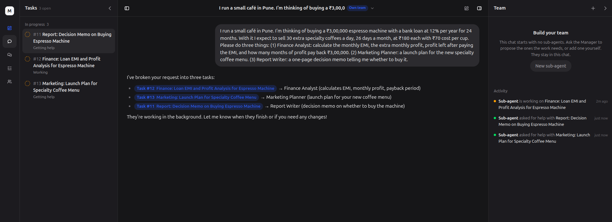
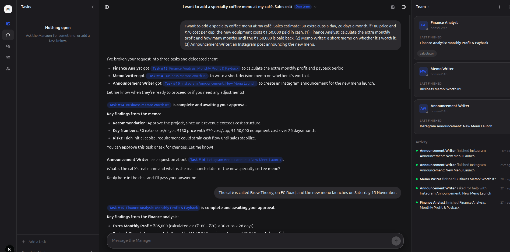

# Mr.ceo

A platform where users create **sub-agents with specific roles or skills**, then give instructions to a single **Manager**. The Manager breaks the work down, delegates it to the right sub-agents, and they work **in the background**, sending updates as they finish.

## Status

> Working prototype: FastAPI backend (Manager + sub-agents, SSE) and a Next.js frontend (tasks, Manager chat, sub-agent conversations). This README is updated as the project progresses.

## Getting Started

Requirements: Python 3.11+ and Node.js 20+. Run the backend and the frontend in two terminals.

**1. Backend** (http://localhost:8000, API docs at `/docs`)

```bash
cd backend
python -m venv .venv
source .venv/bin/activate        # Windows: .venv\Scripts\activate
pip install -r requirements.txt
uvicorn app.main:app --reload --port 8000
```

With no `ANTHROPIC_API_KEY` the backend runs in fake mode (no LLM calls), so you can try the whole flow for free. For real models, create `backend/.env`:

```bash
ANTHROPIC_API_KEY=sk-ant-...
# or use a local model:
# LLM_PROVIDER=ollama
```

**2. Frontend** (http://localhost:3000)

```bash
cd frontend
cp .env.example .env.local       # NEXT_PUBLIC_API_URL, default http://localhost:8000
npm install
npm run dev
```

Open http://localhost:3000, create a sub-agent with the **+** in the right pane, then message the Manager.

Other frontend commands: `npm run typecheck`, `npm run build && npm start`.

## The Idea

```
USER ──► Manager ──► Agent (role a)
                 ├─► Agent (role b)
                 └─► Agent (role c)
            │
            └──► User Response
```

1. The user gives an instruction to the Manager.
2. The Manager plans the work and routes tasks to the required sub-agents.
3. Sub-agents run in the background, so the user isn't blocked waiting.
4. Results flow back to the Manager, which sends progress updates and a final response to the user.

### Core concepts

- **Manager:** the single entry point. It plans, routes, tracks tasks, and summarizes results.
- **Sub-agent:** user-defined configuration (name, role prompt, tools, model, permissions), not custom code. One generic runner executes any of them.
- **Task:** a first-class record (id, assigned agent, status, result, logs). Both the Manager and the UI read from it.
- **Updates:** live progress streamed to the UI, plus notifications for long-running jobs.

## Planned Architecture

```
User ─► API ─► Manager (LLM: plan + route)
                  │ creates Task records
                  ▼
             Job queue
                  │
        ┌─────────┼─────────┐
     Worker    Worker    Worker   (each runs one sub-agent)
        │         │         │
        └────► Task DB ─► event stream (SSE) ─► UI
```

## Planned Stack

**Backend** (`/backend`)
- Python, FastAPI, Pydantic v2
- Postgres (SQLAlchemy 2 async, Alembic)
- Redis + async task queue (ARQ or Taskiq)
- SSE for live updates
- Agent layer: LangGraph or Claude Agent SDK (to be decided)

**Frontend** (`/frontend`)
- Next.js, React, TypeScript
- Tailwind CSS + shadcn/ui
- TanStack Query, Zustand
- Typed API client generated from FastAPI's OpenAPI schema
- Possible: assistant-ui / Vercel AI SDK for chat, React Flow for an agent/task canvas


## Future Capabilities

### Sandboxes for sub-agents

Give each sub-agent an isolated workspace where it can actually *do* things, not just write text.

- **Isolated environment:** a sandbox (e.g. a Docker container or microVM) per task or per conversation, with its own working directory. Sub-agents can run code and scripts, process data, and create or edit files there.
- **Shared with the user:** files a sub-agent produces (reports, spreadsheets, charts, code) are saved as task artifacts. The user can preview and download them from the task view, and the Manager can pass them on to other sub-agents.
- **Opt-in as a skill:** a `sandbox` skill, so only agents that are given it can use it.
- **Safe by default:** no access to the host machine, CPU, memory and time limits, network off unless allowlisted, user approval for risky actions, and cleanup when the work is done.

### Files and attachments (multimodal)

Let the user and the agents work with more than text.

- **Attachments in chat:** the user can attach files (images, PDFs, CSV/Excel, documents) to a message. They are stored with the conversation.
- **Routed by the Manager:** the Manager sees what was attached and passes the relevant files to the sub-agents along with their instruction.
- **Multimodal models:** models that support vision read images and PDFs directly. Other files are converted to text, or placed in the sandbox for a sub-agent to process with code.
- **Files as results:** sub-agents can return files as well as text, using the same artifact storage as the sandbox.
- **Limits:** allowed file types and size limits, and files stay private to their conversation.

## Roadmap

- [ ] Decide agent framework (LangGraph vs Claude Agent SDK)
- [ ] Design the core screens and design system
- [ ] Scaffold backend and frontend, plus docker-compose (Postgres, Redis)
- [ ] Vertical slice: message, Manager dispatches a fake task, worker runs it, SSE streams progress, UI shows result
- [ ] Real Manager routing and sub-agent runner
- [ ] Agent builder UI
- [ ] Auth
- [ ] Limits and safety: per-task step, token, and time caps; human approval for risky actions
- [ ] Sub-agent sandboxes: run code and work on files in isolation, and share the resulting files with the user
- [ ] File attachments and multimodal input: images, PDFs and documents in chat, passed to the right sub-agents

## Project Structure

```
Mr.ceo/
├── backend/     # FastAPI service (see backend/README.md)
├── frontend/    # Next.js app (see frontend/README.md)
└── README.md
```

## Screenshots

### While a query is processing

The Manager has split the request into three tasks and delegated them. Sub-agents work in the background: the tasklist shows each task as *Working* or *Getting help*, and the activity feed shows live updates.



### When the query is completed

Every task has finished and is waiting for the user's approval. A sub-agent's question was asked directly in the chat, the user answered there, and the Manager reported the key results.

